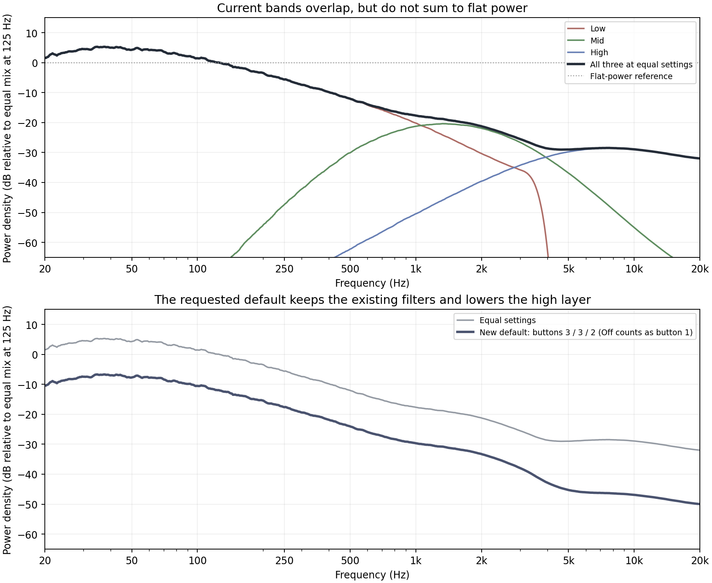

# Band overlap — build 22

The current bands overlap continuously, but they are **not a power-complementary crossover**. Equal button settings preserve a bass-heavy contour with changes in slope; they do not yield flat power per hertz or a mathematically prescribed brown/pink curve. The filters and audio engine are unchanged in this release, preserving the sound the user likes.

## What the controls mean

Each row independently scales its existing layer by Off, −18, −12, −6, or 0 dB relative to that layer's maximum. Equal settings therefore mean equal relative gain, not equal spectral power or perceived loudness. The new fresh-install default selects buttons 3 / 3 / 2, counting Off as button 1: internal Low / Mid / High levels 2 / 2 / 1, or −12 / −12 / −18 dB. Existing saved balances, explicit legacy Brown, and all-Off remain unchanged.

Low uses the approved brown source at 8 kHz, including an 18 Hz leaky integrator, two 35 Hz high-pass stages, and two 1,400 Hz low-pass stages. AVAudioEngine converts it to the output sample rate. Mid uses four 600 Hz high-pass stages and four 3,000 Hz low-pass stages. High uses two 5,000 Hz high-pass and two 10,000 Hz low-pass stages. Mid/High run at 48 kHz. Each source has its own fixed headroom scaling and independent random stream.

For independent layers, expected output power density is

`S_total(f) = g_low² S_low(f) + g_mid² S_mid(f) + g_high² S_high(f)`.

A complementary filter bank designed for independent, equally powered input noise would require the sum of squared filter magnitudes to follow the desired target. For a flat target that sum is constant, as in the [power-complementary condition documented by MathWorks](https://www.mathworks.com/help/dsp/ref/iirpowcomp.html). A shared-source, phase-coherent crossover has a different summation condition. Neither condition is currently enforced by these separately shaped layers. Flat power per hertz is white noise; a warm target would deliberately slope downward. Smoothness and flatness are different properties.

## Measured result

Five deterministic, stereo, 65-second renders used the production C DSP and the actual AVAudioEngine offline resampling/mixing graph: each layer alone, all layers at maximum, and the new default. Analysis excludes the first second. A stereo-averaged Welch estimate uses 2-second Hann windows with 50% overlap; display curves are smoothed over 1/12 octave. Every curve shares the equal-mix power density at 125 Hz as its reference; curves are not independently normalized.

- Equal-setting Low/Mid contributions cross around **1.06 kHz**; Mid/High cross around **3.93 kHz**.
- The combined equal-setting spectrum is about **−17.7 dB at 1 kHz**, **−28.6 dB at 4 kHz**, and **−28.5 dB at 8 kHz**, relative to 125 Hz. The midrange shoulder and flatter high-frequency region show that the response is not one uniform slope. These numbers describe density, not total energy in each band.
- The actual combined samples match the sum of individually rendered layers within **1.49 × 10⁻⁸**. The measured mix PSD agrees with the independent-power prediction within **0.033 dB at the 95th percentile** across analyzed frequencies.
- Observed equal-mix sample peak: **0.2207**; new-default peak: **0.0541**. These are measurements from this sample, not universal peak bounds or acoustic speaker measurements.

The resulting response has no spectral gap at either crossover. The analysis does not establish perceptual smoothness, headphone/speaker response, overnight continuity, or every random realization. Existing continuity/headroom audits remain the baseline. No automatic normalization, limiting, or filter redesign was introduced.

Reproduce using `Scripts/render-stereo.swift` and `Scripts/analyze-band-overlap.py`. Full numeric results and render hashes: [band-overlap-v22.json](band-overlap-v22.json). Renders/logs: `build/release-v22/spectrum/`.

If a future EQ should preserve a specified contour at equal settings, design and validate a power-complementary three-band bank around a chosen warm target. Treat that as a sound change requiring listening comparison with the current mix.
