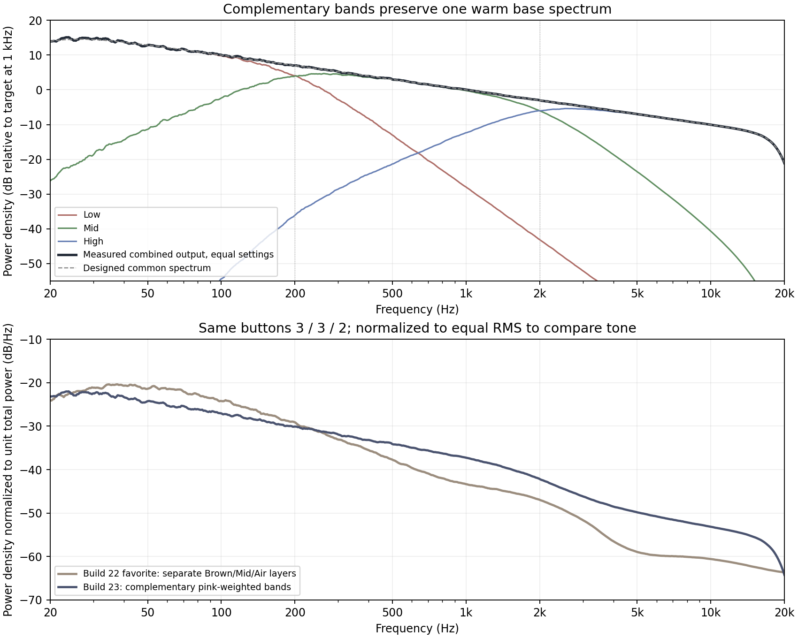

# Fundamental sound engine change — build 23 / complementary design 1

The user authorized a new mathematical sound design on November 15, 2026. This release intentionally changes the sound produced by the same Low/Mid/High settings. The prior favorite is preserved in the public Git tag [`sound-baseline-build-22`](https://github.com/niembro64/EverNoise/tree/sound-baseline-build-22), commit `0aaac39f558f4d8e4b628a22e1da7194aa0e7059`. See [rollback instructions](SOUND_ENGINE_HISTORY.md). No old setting is overwritten; its timbre changes because the active generator changes.

## Design

All three bands now use independently seeded 48 kHz noise and the same fixed pink-weighted coloring filter. Second-order Butterworth splits at 200 Hz and 2 kHz form a tree:

```
Low  = L200
Mid  = H200 × L2000
High = H200 × H2000

|L200|² + |H200|² = 1
|L2000|² + |H2000|² = 1

|Low|² + |Mid|² + |High|² = 1
```

For independent excitations of equal input power, the expected output spectrum is the common base spectrum multiplied by `gLow² |Low|² + gMid² |Mid|² + gHigh² |High|²`. Equal settings therefore preserve one prescribed base curve at every frequency. This is a statistical power identity, not a guarantee that an individual short FFT of random noise will be flat or identical. It does not depend on coherent phase cancellation between the noise streams.

The base uses six first-order shelves approximating `1/f` power, with maximum pinking approximation error **0.0441 dB from 20 Hz to 20 kHz**, before intentional common rolloffs. A 20 Hz high-pass removes DC/subsonic energy, and an 18 kHz low-pass softens the top. These edge rolloffs are part of the target; the complete response is not claimed to be ideal pink noise at the edges. Poles and zeros were fit offline, paired in ascending order to control internal gain, and committed as fixed coefficients. Runtime generation has no dependency on Python, NumPy, or SciPy.

Every band shares the same fixed gain. Impulse L1 norms plus analytic infinite-tail bounds give a combined bound of **0.7999992 full scale before hardware sample-rate conversion**, for every input in `[-1,1]`, every level combination, and the existing convex Mono/Stereo fade. The margin below 0.8 allows for floating-point rounding; the analytic bound is not a formal proof of every machine arithmetic operation. No clipping, compression, limiting, normalization, or automatic volume adjustment is used. The 600 ms level fades, startup/pause/resume fades, persistent random/filter state, and continuous audio-session lifecycle remain.

The five choices remain Off / −18 / −12 / −6 / 0 dB. The default remains buttons **3 / 3 / 2**, counting Off as first, and all saved choices persist. Stereo remains independently generated left/right audio. Mono duplicates the left; the unchanged one-second convex switch can have a temporary right-channel power dip during a mode transition.

## Measured result



- The design's three power weights sum to one within **4.65 × 10⁻¹³** over 290,000 frequency points. The compiled C filters independently verify within **1.21 × 10⁻¹³** over 20 Hz–20 kHz using their actual impulse responses.
- Adversarial, full-scale, reversed-impulse-sign inputs attain the predicted combined bound: **0.799999199999**. Superposition error is **4.65 × 10⁻¹³**, confirming linear behavior in this check.
- **164 new-engine AVAudioEngine renders pass**: all 125 mixes, 32 sample-rate/channel/mode cases, two rapid/mute transitions, and five 65-second spectrum recordings. Rates: 16, 44.1, 48, and 96 kHz; output channels: one and two. All renders completed without retry/stall. All new source clocks advance together.
- The 125 mixes match weighted sums of their isolated bands within **7.48 × 10⁻⁹**. All-Off is exact silence; Mono is identical in both channels. Stereo correlation and channel-power checks pass.
- Maximum measured four-times-oversampled peak after Apple's conversion is **0.101081**, approximately **19.91 dB below full scale**. This is a measured result, separate from the pre-conversion worst-case bound.
- Five 65-second production recordings use 64 steady-state seconds/channel for Welch spectral analysis. The measured equal-setting spectrum agrees with the predicted target within **0.353 dB at the 95th percentile** of the smoothed frequencies, reflecting finite noise-estimation variance.
- All three paired production generators pass **30 accelerated hours each**, **5,184,000,000 frames per channel**, and **2,916 Mono/Stereo changes per band**. Every checked sample is finite and bounded, with no unintended silent buffers. This exercises counters beyond 32-bit range; it is not a physical iPhone overnight test.
- The preserved legacy generator was compared through Apple's engine with build 22 at 44.1/48 kHz in Mono/Stereo: all four comparisons are **bit-identical** (eight renders). An additional 65-second legacy favorite render supports the tone comparison.
- **40 core tests and 32 integration/UI tests pass.** The integration/UI suite passes in one run, including the three 48 kHz production sources, all 125 selection transitions without engine restart, background playback, preferences, visual states, and controls.

The new default has less bass dominance and more mid/treble energy relative to its overall level. Its measured digital RMS is **8.79 dB below the old default** because the new bank uses one conservative common gain. The lower graph normalizes both recordings to equal RMS to compare tone; equal RMS is not equal perceived loudness. Device volume may need adjustment, and speaker/headphone response still matters. Mathematical complementarity does not establish a subjective sleep preference.

## Reproduction and evidence

`scripts/design-complementary.py --write` generates the committed coefficients; without `--write` it verifies them. `scripts/complementary-filter-audit.c` tests the production header and exports four impulses. `scripts/render-stereo.swift` accepts the final argument `complementary`; omitted or `legacy` reproduces the previous renderer. `scripts/check-complementary.py` exercises mixes/conversion and compares a supplied build-22 renderer. `scripts/analyze-complementary.py` creates the report and plot. `scripts/stereo-endurance.c` accepts sources 4, 5, and 6 for the new bands.

Numeric design: [complementary-design-v1.json](complementary-design-v1.json). Complete measurements, hashes, and endurance: [complementary-audit-v23.json](complementary-audit-v23.json). Generated WAVs are temporary and reproducible; their hashes and render logs are retained. Package/source evidence and delivery status are tracked separately in `build-23-manifest.json` and `RELEASE_STATUS.md`.

Physical-device listening, overnight playback, battery, Bluetooth, and all OS interruption combinations remain unmeasured for this generator. The existing audio-session recovery behavior is unchanged; no immunity to system interruptions is claimed.

Primary design references: [power complementarity](https://www.mathworks.com/help/dsp/ref/iirpowcomp.html) and [Butterworth/SOS design](https://docs.scipy.org/doc/scipy/reference/generated/scipy.signal.butter.html).
